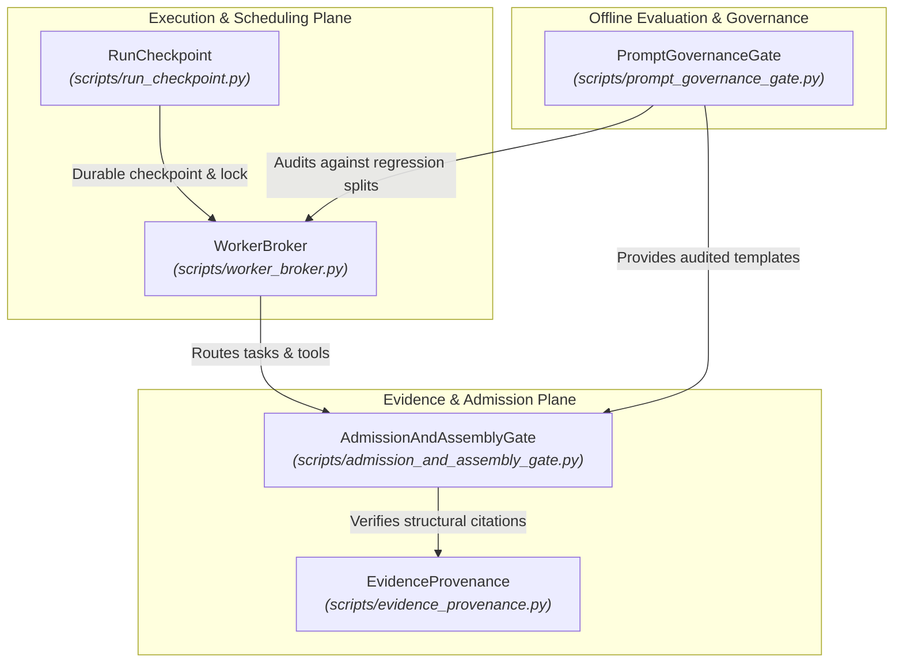

# Mímir Architecture Reference

Mímir is structured around five canonical **deep modules** designed according to deep-module design principles: maximizing **depth** (rich, encapsulated behavior behind narrow, high-leverage interfaces) at clean **seams**, with full **locality** for maintainers and **leverage** for callers.

---

## 1. Architectural Topology



---

## 2. Core Deep Modules

### 2.1 Evidence & Provenance: [`EvidenceProvenance`](file:///C:/Users/jonas/code/skills.sh/mimir/scripts/evidence_provenance.py)
* **Role**: Single authoritative owner of primary source capture, bounded excerpt slicing, deterministic citation verification, numeric-unit association, and conflict detection across worker findings.
* **Interface**:
  - `capture(locator: str, content: str, retrieval_type: str = "primary_document") -> CapturedSource`: Ingests source text with strict bound checks and assigns content-addressed `capture_<sha256>` identities.
  - `bind_span(capture_id: str, span_start: int, span_end: int) -> FrozenSpan`: Binds verified character-offset and line-range excerpts to task contracts.
  - `verify_citation(span: FrozenSpan, claim: MaterialClaim) -> ProvenanceVerdict`: Deterministically validates presence, bounds, and numeric/unit membership. *Note: Yields `REVIEW` or `FAIL`, never `PASS` (since structural presence does not establish semantic entailment).*
  - `detect_conflicts(findings: Sequence[WorkerFinding]) -> List[SourceConflict]`: Preserves incompatible material assertions across findings without premature majority-vote resolution.
  - `from_state(state: Mapping[str, Any]) -> EvidenceProvenance`: Rehydrates store state from serialized run checkpoints.
* **Seam & Adapters**: Sits at the seam between raw workspace/network sources and worker task contracts.
* **ADR**: [`adr-001-evidence-provenance.md`](file:///C:/Users/jonas/code/skills.sh/mimir/artifacts/adr-001-evidence-provenance.md).

---

### 2.2 Admission & Assembly: [`AdmissionAndAssemblyGate`](file:///C:/Users/jonas/code/skills.sh/mimir/scripts/admission_and_assembly_gate.py)
* **Role**: Governs task result checking, batched verification, bounded 2-step execution rephrase repair, 1-step final assembly repair, and quarantine projection.
* **Interface**:
  - `check_candidate(candidate: Dict[str, Any], deps: Dict[str, Any]) -> Dict[str, Any]`: Evaluates atomic worker findings via coalesced checking (up to 4 candidates per batch).
  - `repair_candidate(node: TaskNode, rejection: Dict[str, Any]) -> Dict[str, Any]`: Orchestrates bounded 2-step execution repair without mutating original contracts or loosening acceptance checks.
  - `synthesize_and_repair(context: Dict[str, Any], assembled: Dict[str, Any], feedback: List[str]) -> Dict[str, Any]`: Executes bounded 1-step assembly repair, enforcing strict word caps and quarantine rules.
  - `build_publication_view(context: Dict[str, Any], quarantined: List[Dict[str, Any]]) -> Dict[str, Any]`: Projects released claim aggregates, filtering quarantined tasks into explicit diagnostic appendices.
* **Seam & Adapters**: Placed at the seam between untrusted worker output and the blackboard of accepted facts.
* **ADR**: [`adr-002-admission-and-assembly-gate.md`](file:///C:/Users/jonas/code/skills.sh/mimir/artifacts/adr-002-admission-and-assembly-gate.md).

---

### 2.3 Durable State & Lifecycle: [`RunCheckpoint`](file:///C:/Users/jonas/code/skills.sh/mimir/scripts/run_checkpoint.py)
* **Role**: Controls atomic persistence, OS-level lease locking, DAG identity validation, idempotent publication recovery, and markdown/JSON report rendering.
* **Interface**:
  - `acquire_lock(state_file: Path) -> ContextManager`: Acquires cross-platform file leases with robust Windows stale-lock overrides.
  - `save_state(state: Dict[str, Any], state_file: Path) -> None`: Performs atomic writes via temporary files and `os.replace` with retry backoff.
  - `load_state(state_file: Path) -> Dict[str, Any]`: Rehydrates state while validating schema versions, node integrity, and execution fingerprints.
  - `publish_artifacts(state: Dict[str, Any], output_path: Path) -> Dict[str, Path]`: Atomically renders and flushes `.md`, `.json`, and `.operations.jsonl` reports.
* **Seam & Adapters**: Sits at the seam between the runtime engine and the host filesystem.
* **ADR**: [`adr-003-run-checkpoint.md`](file:///C:/Users/jonas/code/skills.sh/mimir/artifacts/adr-003-run-checkpoint.md).

---

### 2.4 Worker Dispatch & Budgeting: [`WorkerBroker`](file:///C:/Users/jonas/code/skills.sh/mimir/scripts/worker_broker.py)
* **Role**: Intercepts in-process deterministic operations, enforces concurrency semaphores and run budgets, routes tool policies (`text_only` vs `read_only_tools`), and journals all LLM invocations.
* **Interface**:
  - `dispatch_task(node: TaskNode, ...)`: Inspects task contracts to route deterministic math to the local formula engine and deducts appropriate tool restrictions.
  - `invoke(prompt: str, role: str, ...)`: Central dispatch managing attempts, deadline timeouts, token thresholds, and budget reservations for final synthesis.
  - `spawn(...)` / `spawn_restricted(...)`: Direct drop-in compatibility for native adapters (Codex, Claude, AGY, OpenCode).
  - `budget_status`: Live property exposing deadline, attempts used, remaining publication headroom, and token counts.
* **Seam & Adapters**: Placed at the seam between orchestration (`scheduler.py`, `engine.py`) and external LLM transports.
* **ADR**: [`adr-004-worker-broker.md`](file:///C:/Users/jonas/code/skills.sh/mimir/artifacts/adr-004-worker-broker.md).

---

### 2.5 Prompt Governance & Auditing: [`PromptGovernanceGate`](file:///C:/Users/jonas/code/skills.sh/mimir/scripts/prompt_governance_gate.py)
* **Role**: Provides authoritative prompt template resolution, cryptographic digest caching, untrusted context boundary defense, and held-out regression auditing.
* **Interface**:
  - `render_template(template_name: str, context: Optional[Mapping[str, Any]] = None, **kwargs) -> str`: Caches templates and substitutes structured bindings (`{{context}}`, `{key}`).
  - `assemble_task_prompt(node: TaskNode, ...) -> str`: Enforces strict isolation between system instructions and untrusted source/dependency text to prevent prompt injection.
  - `project_model_view(obj: Any, sources: Sequence[Any]) -> Any`: Masks sensitive source data and formats compact model views.
  - `compact_checker_context(context: Mapping[str, Any]) -> Dict[str, Any]`: Deduplicates candidate inputs and extracts shared source registries for checker calls.
  - `audit_candidate(name: str, candidate_prompt: str, baseline_prompt: str) -> AuditVerdict`: Evaluates prompt changes against failure regression suites to detect regressions or held-out data leakage.
* **Seam & Adapters**: Sits at the boundary between prompt authoring/evolution (GEPA) and runtime task execution.
* **ADR**: [`adr-005-prompt-governance-gate.md`](file:///C:/Users/jonas/code/skills.sh/mimir/artifacts/adr-005-prompt-governance-gate.md).

---

## 3. Legacy Shims & Backward Compatibility

All previous shallow interfaces remain functional as thin re-export shims to guarantee backward compatibility with legacy scripts, external callers, and existing tests:

| Legacy Module | Status | Forwarding Destination |
| :--- | :--- | :--- |
| `scripts/source_store.py` | Shim | [`EvidenceProvenance`](file:///C:/Users/jonas/code/skills.sh/mimir/scripts/evidence_provenance.py) |
| `scripts/source_binding.py` | Shim | [`EvidenceProvenance`](file:///C:/Users/jonas/code/skills.sh/mimir/scripts/evidence_provenance.py) |
| `scripts/source_support.py` | Shim | [`EvidenceProvenance`](file:///C:/Users/jonas/code/skills.sh/mimir/scripts/evidence_provenance.py) |
| `scripts/retrieved_evidence.py` | Shim | [`EvidenceProvenance`](file:///C:/Users/jonas/code/skills.sh/mimir/scripts/evidence_provenance.py) |
| `scripts/result_batcher.py` | Shim | [`AdmissionAndAssemblyGate`](file:///C:/Users/jonas/code/skills.sh/mimir/scripts/admission_and_assembly_gate.py) |
| `scripts/assembly_gate.py` | Shim | [`AdmissionAndAssemblyGate`](file:///C:/Users/jonas/code/skills.sh/mimir/scripts/admission_and_assembly_gate.py) |
| `scripts/post_worker.py` | Shim | [`AdmissionAndAssemblyGate`](file:///C:/Users/jonas/code/skills.sh/mimir/scripts/admission_and_assembly_gate.py) |
| `scripts/invocation_broker.py` | Shim | [`WorkerBroker`](file:///C:/Users/jonas/code/skills.sh/mimir/scripts/worker_broker.py) |
| `scripts/prompt_data.py` | Shim | [`PromptGovernanceGate`](file:///C:/Users/jonas/code/skills.sh/mimir/scripts/prompt_governance_gate.py) |

---

## 4. Verification

The architecture is covered by dedicated unit test suites for each deep module along with the end-to-end regression battery:

```powershell
.\.venv-research\Scripts\python.exe -m pytest tests/test_evidence_provenance.py tests/test_admission_and_assembly_gate.py tests/test_run_checkpoint.py tests/test_worker_broker.py tests/test_prompt_governance_gate.py tests/test_mimir_config.py tests/test_checkpoint_loading_and_e1_regression.py tests/test_prompt_comparison.py tests/test_review_hardening.py tests/test_assembly_repair.py tests/test_research_program.py -q
# Result: 107 passed, 8 subtests passed in 31.10s
```
