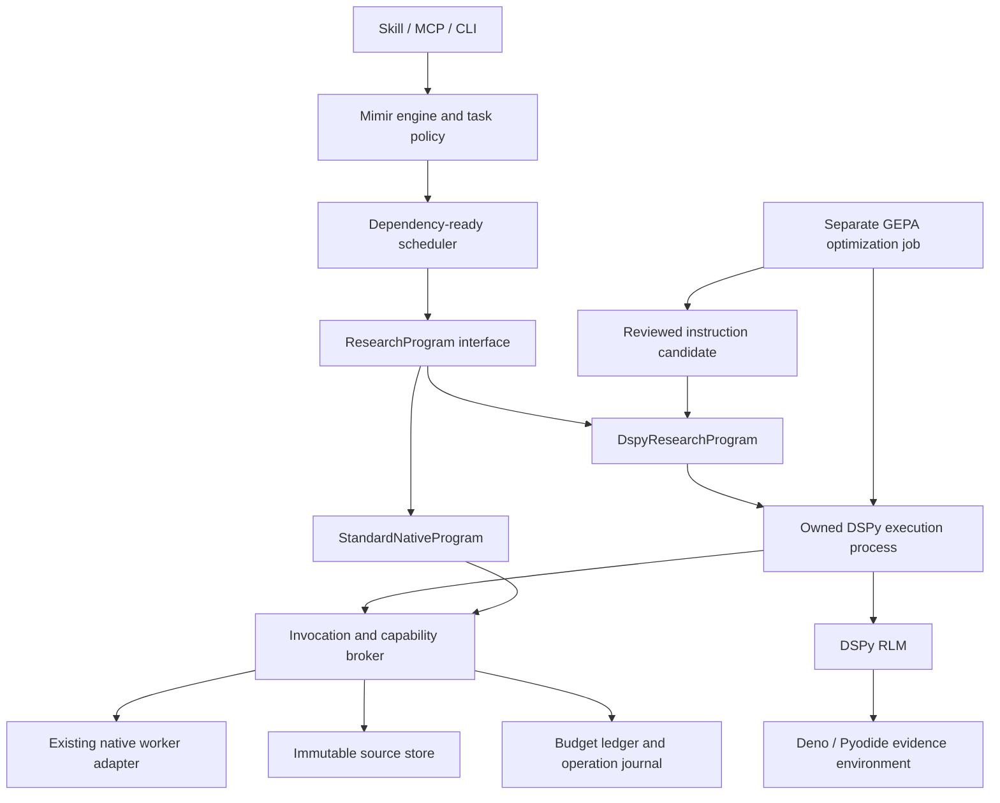

# DSPy and RLM implementation design

> Historical development snapshot. Local run/capture artifacts were cleared
> during workspace cleanup; use current setup docs and tests to reproduce behavior.

Date: 2026-10-22. Status: design proposal; no runtime implementation or installation.

Implement the original ambition as a real DSPy research program with RLM evidence exploration and separately evaluated GEPA instruction optimization. Keep Mimir's existing native worker lifecycle, dependency-ready scheduler, evidence records and durable run manager.

The recommended upstream foundation is **DSPy 3.4.1**, which already provides `dspy.RLM`, a Deno/Pyodide interpreter, normalized custom LM engines and `dspy.GEPA`. Do not build a second RLM loop or represent the existing task decomposer as RLM. DSPy/RLM remains explicitly selected during qualification; successful qualification is a milestone toward the original objective, not indefinite deferral.

## Evidence and what remains unproved

The Mimir review used two specialists, a dependent critic and synthesis, using native Codex `gpt-6.1-sol`, low effort. Report (historical local file: `../.mimir/runs/51217d95cf65437595c40f1719a8dcc2/report.md`) and sidecar (historical local file: `../.mimir/runs/51217d95cf65437595c40f1719a8dcc2/report.json`) preserve worker findings and retrieval gaps. Worker HTTPS attempts failed; workers examined source snapshots retrieved by the host during this design session. Their statements about no native calls describe their own investigation, not the hosting review.

Host retrieval through GitHub's contents/release APIs and PyPI succeeded without changing TLS verification. Sources, blob identities and UTC retrieval times are retained in `artifacts/dspy-rlm-design-2026-10-22/`. The host additionally retrieved the published wheel into memory, checked its PyPI SHA-256, and compared the five decisive source modules against the release tag after normalizing Windows newlines. All five match. The wheel metadata reports 3.4.1, although the tagged source pyproject retains 3.4.0. This resolves correspondence for the inspected modules; it does not prove all release files or dependencies compatible. See wheel provenance (historical local file: `../artifacts/dspy-rlm-design-2026-10-22/wheel-provenance.json`).

Live native bridge semantics, sandbox enforcement, cancellation, Windows packaging and comparative research quality have not been tested. Current Python is 3.14.2; `deno` was not found on PATH. No package was installed, no provider settings changed, and no research-quality improvement is claimed.

## Decisions

| Question | Proposed decision | Reason |
| --- | --- | --- |
| DSPy interface | Normalized `complete(Request) -> Response`, with sync and async engines | Legacy `BaseLM.forward/aforward` is deprecated for removal in 3.5. |
| RLM implementation | Reuse DSPy's RLM and interpreter factory | Programmatic context inspection, semantic queries and nested DSPy predictors already exist upstream. |
| Native execution | Adapt Mimir's existing SDK-owned agent turns | Preserve the agreed provider, model, effort, credentials and billing path. |
| First RLM input | Immutable local corpus with original source locators and spans | Prove large-context exploration independently of live retrieval. |
| Recursive computation | First semantic subqueries; then guarded nested `dspy.RLM` | Each stage has a concrete gate; avoid inventing another recursive orchestration framework. |
| Program execution | Owned DSPy execution subprocess, with parent-owned invocation broker | Support threaded sync calls and forcibly terminate stuck program/interpreter execution. |
| Generated-code execution | Deno/Pyodide with narrowly configured access | In-process Python `exec` and unrestricted CPython subprocesses do not confine generated code. |
| Optimization | Separate upstream DSPy GEPA workflow; instruction optimization only initially | Dataset-scored program improvement is different from revising one answer. |
| Candidate activation | Reviewed instruction manifest selected by identity | Prevent training outputs from changing permissions, executable code or every future run automatically. |

## Architecture and module interface



The new deep module is `ResearchProgram`: callers supply a task request and an execution context and receive one typed research outcome. Its implementation hides message conversion, DSPy execution, context exploration, recursion, trace collection and failure reconciliation.

```python
class ResearchProgram(Protocol):
    async def run(
        self, request: ResearchRequest, context: ResearchContext
    ) -> ResearchOutcome: ...
```

`ResearchRequest` contains the immutable task objective, dependency evidence, source-manifest identity, selected program/instruction identities and capability policy. `ResearchContext` supplies the injected invocation broker, source store, budget ledger, cancellation scope and journal. These are internal seams; MCP callers do not construct SDK clients or know DSPy interpreter details.

`ResearchOutcome` contains `state` (`completed`, `failed`, `cancelled`, `budget_exhausted`), existing `answer/sources/claims/gaps` records, qualified usage and a trace-manifest reference. `completed` describes execution, not independently verified research. Required operation failure cannot be represented as completed merely because the model subsequently supplied an answer.

There are two real adapters: `StandardNativeProgram` preserves current single-worker behavior, and `DspyResearchProgram` executes typed prediction or RLM. Adapt the scheduler at its worker invocation seam, keeping readiness, result admission and persistence there. Do not implement research dispatch by further monkey-patching `backend.spawn`.

Initially route investigator tasks through the selected program. Planning, the critic and final synthesis retain current behavior and share the broker's accounting. Later migration of those prompts into DSPy modules is separately evaluated. Do not append another synthesis merely because the investigator used RLM.

## Native LM bridge

An ordinary native worker is **an agent turn**, potentially containing tools and multiple provider completions. It is not directly a DSPy LM. The adapter's declared semantics are one normalized DSPy completion implemented by one native agent turn.

Use `dspy.LM` with an explicit custom synchronous engine and asynchronous engine. Avoid `engine="auto"`, LiteLLM inference, and the upstream Codex OAuth Responses adapter. The latter is a different transport and authentication seam from the selected Mimir SDK runtime. Presence of LiteLLM as a dependency does not authorize routing calls through it.

The bridge must:

1. Accept a validated text request; preserve role ordering and instruction precedence in a versioned serialization. Text delimiters are not a substitute for native instruction hierarchy. Bind policy outside model-produced content.
2. Dispatch through the parent-owned broker with fixed model and low effort. Pass only selected context and the appropriate native developer instructions.
3. Return the native final response as text. Current adapters may parse JSON into `SwarmResult.data`; use `raw_response` when DSPy needs its own parsing, rather than stringifying that parsed dictionary.
4. Map completed, refused, interrupted, invalid and failed native outcomes to normalized response/error types. Preserve cancellation and budget failures as fatal control outcomes.
5. Reject unsupported multimodal input, tool-call requests, sampling controls, output-token guarantees and policy overrides explicitly. Support response schemas only after mapping is tested. Initial requests produce one text response; no implicit `n > 1` fan-out.
6. Keep aggregate native usage in qualified metadata when that is all the adapter supplies. Do not fabricate input/output token counts or pricing. Pin and test the normalized usage mapping.

DSPy's defaults include cache and retries. Initially use `cache=False, num_retries=0`; the broker owns any explicitly configured retry policy. Every actual retry consumes an attempt reservation. If caching is later enabled, cache identity includes corpus, execution profile, program, permissions and dependencies; cache hits are not fresh provider usage.

Native retrieval and native delegation must be disabled for RLM root and semantic calls through an enforced per-invocation tool policy. The current Codex adapter's filesystem read-only mode and deny-all approvals do not establish that inherited MCP operations are disabled. Implement and verify tool restrictions in the adapter before the live first slice. If the runtime cannot enforce the required policy, stop qualification with an explicit unsupported-capability outcome. Do not substitute prompt instructions or silently switch providers.

## DSPy execution, thread ownership and cancellation

DSPy's RLM offers async execution, but its batched semantic queries also call synchronous LMs from a thread pool. Interpreters must stay on the thread where first used. A design based only on `await rlm.acall(...)` misses those paths.

Run trusted DSPy program code in an owned execution subprocess. Create each interpreter and run its complete invocation on one designated execution thread. Synchronous LM engines submit correlated IPC requests to the parent and wait for replies; async engines use the same broker protocol. The parent runs native SDK clients and async synchronization on its owning event loop. No SDK object, semaphore or event loop crosses processes/threads.

IPC is bounded and typed: request ID, parent ID, program invocation ID, operation type, selected input and validated response. A single process reader demultiplexes replies; serialize writes and reject duplicate, oversized or stale messages. Do not interpolate shell commands or accept executable Python over the broker. Pipes are private to owned processes; logs contain operation metadata, not credentials.

DSPy's execution subprocess receives only required runtime environment variables. Native credentials stay with the parent native runtime. Generated Python executes only in the Deno guest; the trusted DSPy process itself is not an OS security sandbox.

Cancellation closes admission, cancels all broker futures, interrupts active native turns and joins their cleanup, then terminates owned execution/interpreter descendants if cooperative shutdown fails. Use a Windows Job Object or equivalently tested process-tree ownership so killing the DSPy process cannot leak Deno. A stuck guest infinite loop must be terminable. No successful publication until all owned work is joined. Shutdown/cancellation failures remain visible.

## Evidence environment and capabilities

Large context lives in the RLM environment, not in a larger initial prompt. Supply frozen source text plus compact metadata or bounded source handles. Root prompts describe the corpus and its schema; RLM-generated code searches, slices and compares actual data, invokes semantic queries over selected spans, and submits source-linked results.

Source records retain original locator, actual retrieval time/type, immutable content digest, source revision when available, extraction version and span coordinates in the normalized text. Preserve original bytes or their captured identity separately. Derived summaries refer to their parent sources and spans and remain derived evidence.

Keep the capability surface small:

- `list_sources` returns metadata within the task's manifest.
- `read_span` returns a bounded span by source ID and coordinates.
- `search_sources` returns bounded literal/regex matches with source spans.
- Later `retrieve_source` uses only approved operation types and scope, returning captured source records.

RLM's `llm_query` handles semantic interpretation; it does not receive general host tool objects. Source IDs are task-scoped, not arbitrary file paths or URLs. Validate bounds, input/output size and capability scope for every callback. Avoid regex inputs that can monopolize the parent process; bounded literal search is the first implementation.

The proposed interpreter uses no writable host mounts, guest environment access or arbitrary network access. It receives corpus values or explicitly read-only corpus mounts; set `sync_files=False`. Runtime loading permissions and caches are narrowly scoped. Upstream runner loads Pyodide and revokes cache read permission after startup; verify effective permissions with adversarial execution. Prewarm runtime dependencies through setup so investigating private evidence does not implicitly fetch packages. Reject generated-code package imports that require network installation.

Enforce deadlines, payload/output limits and tested process resource limits. `max_output_chars` is a prompt-output control, not a whole-process memory cap. If the runtime cannot enforce a requested resource constraint, report that limitation or reject strict mode.

Exact source spans prove where text came from; they do not prove claim entailment or source authority. Continue current support-status and gap semantics, with independent review for material claims.

## Real recursion

The first working RLM slice permits interpreter actions and semantic subqueries, with nested DSPy predictor construction disabled. It demonstrates real context exploration and submodel calls, but does not satisfy the later nested-RLM milestone.

Next enable nested `dspy.RLM` through the upstream sandbox facade, using a guarded interpreter factory and broker. Nested RLMs reuse the approved program configuration, source scope and global ledger. Do not add dynamic outer DAG nodes or a second recursive ResearchProgram framework for this step.

DSPy's facade can construct multiple predictor kinds and supply options. Its own allowed options are broader than Mimir's fixed profile. A Mimir adapter must validate predictor kind/options and enforce depth at construction/invocation, including copied LMs. No caller-selected interpreter, credentials, model, effort, permissions or retry policy. Each child gets a stable parent ID; interpreter construction depth and model dispatch depth must agree. Merely creating a fresh local `max_llm_calls` counter is insufficient.

Qualification must demonstrate a nested RLM analyzing a subset in its own fresh interpreter and returning to its parent. Global budget exhaustion must prevent additional children at every path. If this requires patching upstream private methods, isolate and version that patch and pursue an upstream public policy hook; do not spread facade internals through Mimir.

Workers keep their no-native-delegation and no-Mimir-invocation rules. Engine-mediated recursive computation is the explicitly enabled exception, not authorization to launch arbitrary agents.

## Budget ledger and operational truth

One parent-owned ledger covers planning, investigators, critic, synthesis, RLM actions/extraction, semantic queries, nested predictors, retries, retrieval and optimization reflection. Reserve before an effect; commit observed usage after completion. A checkpointed ambiguous in-flight attempt remains consumed until reconciled.

| Control | Proposed guarantee |
| --- | --- |
| Native attempts | Hard admission limit on broker dispatches, including retries; separate from logical DSPy calls. |
| Recursive depth | Hard limit across nested invocations, not per-child reset. |
| Active native turns | Shared concurrency permits held only during actual native turns. |
| Interpreters | Separate active-interpreter/resource limit, with fail-fast child admission to avoid resource deadlocks. |
| Time | Whole-run deadline plus per-operation deadlines and joined termination. |
| Input/output | Explicit selected-context, source-result, IPC and guest-output size limits. |
| Tokens | Reported usage plus conservative admission estimates; no hard provider-token ceiling when the native runtime cannot enforce one. |
| Cost | Unknown until authoritative accounting exists; no dollar-budget guarantee from guessed token pricing. |

A waiting parent must not hold a native-turn permit needed by children. Test native concurrency one. A parent interpreter remains live while awaiting children, so a exhausted interpreter slot must reject a child rather than wait indefinitely.

Admission reserves some attempt capacity for mandatory critic/synthesis stages. Publish the reservations as part of the plan. If investigator demands exceed its allowance, return a budget-exhausted outcome; do not silently remove review stages. Illustrative calibration settings are 6 root iterations, 4 semantic calls, depth 0 and native concurrency 1 for the first slice. These are proposed test settings, not new defaults or a promise about total internal model calls.

Separate logical predictor calls, actual native attempts, cache hits, observed tools, reported tokens, estimates and missing usage. Native agent turns can contain opaque internal calls. Stop further admission when reported usage exceeds a threshold, while disclosing that the just-completed turn may have overshot it.

## Durable state and recovery

Extend existing task fingerprints with program/instruction identity, dependency lock, immutable source manifest, capability/tool policy, interpreter policy, broker serialization version and native execution profile. Freeze these at planning; resume cannot silently change them.

Persist operation reservation, parent/depth, sanitized input identity, response identity, terminal state, observed usage and captured source identity. Persist complete required results before downstream task admission. Raw private corpus/trajectories remain in project run storage, with no credentials or automatic global learning promotion. Routine host progress stays concise; source/code/operation diagnostics remain in artifacts.

First recovery support reuses completed task outcomes and completed source retrievals. Restart interrupted RLM analysis from immutable sources; do not promise resumable interpreter memory. Repeated work is recorded and charged. Unresolved remote dispatch cannot be treated as exactly-once execution.

Only later introduce replay: recorded callbacks are replayed without effects; nondeterministic code is constrained or divergence rejects replay. Live source changes create a new manifest and invalidate affected descendants. Do not load pickled programs or serialized engines from worker outputs; load reviewed data-only instruction manifests and inject the trusted runtime engine.

DSPy may convert some batched LM failures into text, and extraction can still produce an answer. The broker retains authoritative required-operation failure state. Optional-source failures may produce a completed report only when explicitly optional in policy and retained as gaps. Model-generated error strings cannot decide success.

## GEPA optimization and evaluation

Use upstream `dspy.GEPA` after the research module and evidence rubric work. Supply a real DSPy student module, training examples, explicit development/validation examples, scored feedback and the same native reflection bridge. Optimization is a separate durable job, not a hidden stage in every research run. Retain the legacy custom optimizer for compatibility and distinguish it clearly.

Initially optimize investigator/action/extraction instructions only. Freeze tool permissions, model/effort, interpreter settings, recursion policy, data schema and executable program code. Do not enable GEPA code evolution, remote tracking or automatic candidate loading.

Create a small first benchmark with frozen corpora: 12 training, 6 development and 6 sealed held-out cases, grouped by source/topic lineage to avoid near-duplicate leakage. Those counts are an initial engineering fixture, not evidence of statistical sufficiency. Grow and repeat it before general claims. Include scattered facts, misleading similar passages, conflicting revisions, missing sources, unsupported claims, instruction injection, failed subqueries and sources exceeding root context admission.

Compare four configurations with the same worker profile and observable attempt/time limits: standard-native, typed DSPy prediction, unoptimized DSPy RLM, optimized DSPy RLM. Give the standard adapter approved access to the same corpus; do not deliberately handicap it by withholding retrieval. Separate quality and reliability cases from latency measurements.

The reviewed metric records correctness, claim-level source support, handling of conflicts/gaps, omissions and human correction effort. Locator presence is diagnostic. Begin with deterministically checkable answers/spans plus blinded human entailment review; any model grader is supplementary and its calls enter accounting. Training/dev feedback must never include held-out answers.

Use GEPA's explicit metric-call limit and the global broker limits together. Metric calls are not native model calls. Disable optional merge/code-evolution complexity initially. Preserve dataset digests, rubric version, student/instruction identity, candidate parentage, feedback, usage limitations and test results. Native sampling may be nondeterministic; record repeated-run variation rather than promising reproducibility from a seed.

Candidate artifacts contain instructions and provenance data, not client credentials or arbitrary import paths. A reviewed candidate must pass correctness/support non-regression, required failure/injection checks and agreed time/attempt limits on sealed data. Declare thresholds before evaluating candidates; the first quality baseline establishes useful thresholds, not fabricated pass rates. Activation selects a reviewed manifest by identity with an explicit rollback target. No automatic promotion into `.mimir/LEARNINGS.md`.

## Configuration and migration

Keep task topology (`single/review/swarm`) separate from investigator implementation (`native/dspy/rlm`). An RLM investigator can serve a focused single run or specialists in review/swarm. Mode names must not imply automatic optimization.

Proposed controls: `research_program`, optional reviewed `program_manifest`, and one structured `research_budget` containing attempt/depth/time/payload/interpreter limits. CLI can expose common fields as flags while MCP accepts a validated structured object. New settings are frozen in checkpoints, diagnostics and sidecars. Existing runs without these settings use `native`.

Propose a separate optional dependency set starting with `dspy[deno]==3.4.1`. Its published metadata requires `gepa[dspy]==0.1.4` on this Python version. Select an exact supported Deno 2.x package and transitive lock after resolver/platform tests in an isolated environment; do not change the current production workspace environment during that experiment. RLM remains experimental upstream, so lock tested versions and make unsupported startup explicit.

Legacy flags and ordinary native behavior remain available during migration. Once qualification passes, document when the skill selects DSPy/RLM, what capability was actually executed and what remains limited. Package installation and skill refresh happen with implementation, not this design document.

## Implementation work packages

| Stage | Work | Acceptance gate |
| --- | --- | --- |
| 1. ResearchProgram and ledger | Standard adapter, injected broker, shared attempt accounting, versioned fingerprints | Native behavior parity; mandatory stage reservations; completed-result reuse; cancellation/failure truth. |
| 2. Normalized native bridge | Sync/async engines, private IPC, raw text and failure mapping, enforced native tool policy | One typed prediction and bounded parallel predictions using unchanged native configuration; unsupported controls rejected; no cross-loop clients; no forbidden tools. |
| 3. First RLM slice | Frozen corpus, Deno environment, action/extraction modules, semantic queries and traces | Corpus exceeds prompt limit; selected spans reach subqueries; answer matches checked evidence; concurrency-one, infinite-loop termination, denied access and failure tests pass. |
| 4. Nested RLM and recovery | Guarded facade/factory, global depth, child operation IDs, task restart and source-drift rejection | Trace proves nested interpreter computation; all children metered; budget/cancellation joins all owned work; no deadlocks or false success. |
| 5. Approved retrieval | Narrow source retrieval callbacks and capture | Actual operation allowlists; bounded source records; no arbitrary paths/remote writes; changed source identities invalidate reuse. |
| 6. Benchmark and GEPA | Source-grouped datasets, stable reviewed metric, upstream optimizer and candidate manifests | Measured standard/DSPy/RLM comparison; held-out isolation; instruction-only candidates; explicit reviewed activation/rollback. |
| 7. Skill/package delivery | Validated controls, diagnostics, reference docs, installer and transport integration | Required unit/adapter/stdio checks; installed identity match; evidence-qualified native end-to-end run. |

Suggested implementation files: `scripts/research_program.py` for the external interface and standard adapter; `scripts/invocation_broker.py` for ledger/journal/dispatch; a `scripts/dspy_runtime/` package for normalized engines, owned process, interpreter policy and typed modules; `scripts/source_store.py` for captured evidence; and `scripts/optimize_program.py` for separate optimization. Extend scheduler/engine/run-manager/CLI/MCP at existing seams. Avoid creating one public abstraction per configuration field.

The first implementation target is stages 1–3. Stages 4 and 6 are explicit completion criteria for the original recursive/optimized-program objective; the first slice alone must not be presented as delivering the entire vision.

## Alternatives and unresolved decisions

Standalone `alexzhang13/rlm` has real recursion and a Docker environment, with depth/iteration/concurrency controls. The host retrieved its README and focused core/Docker source at recorded blob identities. That establishes mechanisms, not a tested Windows/native Mimir integration. Its documented timeout/token stopping can return a best answer, requiring adaptation to Mimir's failure semantics. Prefer DSPy's common module/optimizer system unless qualification exposes a concrete blocker; do not integrate both preemptively.

Open implementation questions are exact native tool-policy enforcement, normalized usage representation, guarded facade public hooks, Deno offline package loading and Windows process resource limits. These have concrete tests in stages 2–4. They are not reasons to silently drop DSPy/RLM or adopt another billing route.

## Primary sources

- [DSPy 3.4.1 release](https://github.com/stanfordnlp/dspy/releases/tag/3.4.1) and [PyPI metadata](https://pypi.org/pypi/dspy/3.4.1/json).
- [RLM module](https://github.com/stanfordnlp/dspy/blob/3.4.1/dspy/predict/rlm.py), [RLM docs](https://github.com/stanfordnlp/dspy/blob/3.4.1/docs/docs/api/modules/RLM.md), [interpreter](https://github.com/stanfordnlp/dspy/blob/3.4.1/dspy/primitives/python_interpreter.py), [runner](https://github.com/stanfordnlp/dspy/blob/3.4.1/dspy/primitives/runner.js), and [nested facade](https://github.com/stanfordnlp/dspy/blob/3.4.1/dspy/primitives/facade.py).
- [Normalized engine migration](https://github.com/stanfordnlp/dspy/blob/3.4.1/docs/docs/community/normalized-lm-api-migration.md), [engine tutorial](https://github.com/stanfordnlp/dspy/blob/3.4.1/docs/docs/tutorials/custom_lm_engines/index.md), [LM implementation](https://github.com/stanfordnlp/dspy/blob/3.4.1/dspy/clients/lm.py), and [normalized types](https://github.com/stanfordnlp/dspy/blob/3.4.1/dspy/_vendor/lm15/types.py).
- [DSPy GEPA integration](https://github.com/stanfordnlp/dspy/blob/3.4.1/dspy/teleprompt/gepa/gepa.py), [GEPA 0.1.4 release](https://github.com/gepa-ai/gepa/releases/tag/v0.1.4), and [GEPA optimization interface](https://github.com/gepa-ai/gepa/blob/v0.1.4/src/gepa/api.py).
- [Standalone RLM](https://github.com/alexzhang13/rlm), [core](https://github.com/alexzhang13/rlm/blob/main/rlm/core/rlm.py), and [Docker interpreter](https://github.com/alexzhang13/rlm/blob/main/rlm/environments/docker_repl.py). These main-branch sources can drift; local `.source.json` files retain the retrieved blob identities.

This design incorporates the critic's corrections and additional host retrieval after the Mimir review. The generated review's release-correspondence and unretrieved-source gaps describe its supplied evidence; the host findings above narrow those gaps without rewriting the run's historical report.
