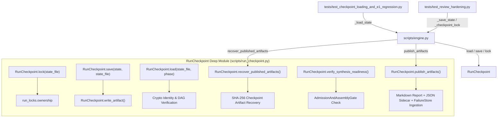

# ADR-003: Consolidate Run Checkpoints, Phase-Resume Verification, and Publication behind RunCheckpoint

- **Status**: Accepted & Implemented
- **Date**: 2026-10-26
- **Context**: `/improve-codebase-architecture` workflow on `mimir` codebase
- **Domain Term**: [`RunCheckpoint`](file:///C:/Users/jonas/code/skills.sh/mimir/GLOSSARY.md)

---

## 1. Context

In `mimir`, checkpoint management, atomic artifact writes, cross-phase resume validation, and final publication rendering were split between `scripts/run_locks.py` and ~500 lines of procedural logic scattered throughout [`scripts/engine.py`](file:///C:/Users/jonas/code/skills.sh/mimir/scripts/engine.py):

1. **Procedural Invariants Scattered**:
   - `_checkpoint_lock`, `_write_artifact`, `_save_state`, and `_load_state` lived directly in `engine.py`.
   - `_load_state` contained 100+ lines of critical cryptographic identity validation (`result_hash`, `evidence_hash`, `input_fingerprint`), acyclic graph checks, and phase-transition guards.
2. **Duplicated Publication Recovery & Pre-Flight Logic**:
   - `_run_synthesize_stage` contained procedural checks verifying whether on-disk artifacts matched the checkpoint's SHA-256 hashes, alongside pre-flight admission checks.
3. **Monolithic Publication Formatting**:
   - Report formatting, JSON sidecar building, token usage telemetry aggregation, and `FailureStore` quarantine ingestion occupied ~340 procedural lines inside `_run_synthesize_stage`.

---

## 2. Decision

We created [`scripts/run_checkpoint.py`](file:///C:/Users/jonas/code/skills.sh/mimir/scripts/run_checkpoint.py) implementing the [`RunCheckpoint`](file:///C:/Users/jonas/code/skills.sh/mimir/GLOSSARY.md) **deep module**. It encapsulates state serialization, exclusive OS lease locking, cryptographic resume integrity, and atomic artifact publication behind a unified **seam**:

### Module Interface & Seam Operations

1. `RunCheckpoint.lock(state_file: str)`:
   - OS-held exclusive non-blocking lease context manager for run phases.
2. `RunCheckpoint.write_artifact(target: Path, content: str) -> None`:
   - Atomic temporary file write with Windows `PermissionError` retries.
3. `RunCheckpoint.save(state: Dict[str, Any], state_file: str) -> None`:
   - Atomic JSON serialization stripping in-memory runtime objects (`task_graph_obj`, `blackboard`).
4. `RunCheckpoint.load(state_file: str, phase: str) -> Dict[str, Any]`:
   - Phase-transition verification, DAG integrity validation, incomplete task reset for `execute`, and cryptographic identity validation (`result_hash`, `evidence_hash`, `input_fingerprint`) for `synthesize`.
5. `RunCheckpoint.validate_output_paths(state_file: str, output_path: str) -> None`:
   - Validates that report, JSON sidecar, state file, and lock paths are mutually distinct.
6. `RunCheckpoint.recover_published_artifacts(...) -> Optional[Dict[str, Any]]`:
   - Idempotently recovers previous publication if report and JSON sidecar match checkpoint SHA-256 hashes.
7. `RunCheckpoint.verify_synthesis_readiness(state, swarm=None) -> None`:
   - Verifies all completed tasks satisfy the active `result_gate_policy` before synthesis.
8. `RunCheckpoint.compute_usage_summary(calls: List[dict]) -> dict`:
   - Aggregates token, cost, and duration telemetry.
9. `RunCheckpoint.publish_artifacts(...) -> tuple[Path, Path, str, bool]`:
   - Renders Markdown report and structured JSON sidecar, ingests any quarantined findings into `FailureStore`, and records publication hashes.

---

## 3. Invariants Preserved

1. **Exact Error Strings & Behavior**:
   - Preserved exact `ValueError` and `ConfigurationRequired` messages required by `tests/test_checkpoint_loading_and_e1_regression.py` and `tests/test_review_hardening.py`.
2. **Backward-Compatible Shims in `engine.py`**:
   - Preserved `_checkpoint_lock`, `_write_artifact`, `_save_state`, and `_load_state` in [`scripts/engine.py`](file:///C:/Users/jonas/code/skills.sh/mimir/scripts/engine.py) delegating to `RunCheckpoint`.
3. **Local Substitutability**:
   - `RunCheckpoint` operates on local `Path` targets and `tmp_path` fixtures without external cloud or environment dependencies.

---

## 4. Verification

- **Direct Unit Tests**: [`tests/test_run_checkpoint.py`](file:///C:/Users/jonas/code/skills.sh/mimir/tests/test_run_checkpoint.py) (7 tests passed in 0.10s).
- **Regression Suites**:
  - `tests/test_checkpoint_loading_and_e1_regression.py` (all tests passed).
  - `tests/test_review_hardening.py` (all tests passed).
  - `tests/test_admission_and_assembly_gate.py` (all tests passed).
  - `tests/test_evidence_provenance.py` (all tests passed).
  - Overall deepened suites: 43 passed in 0.89s.
