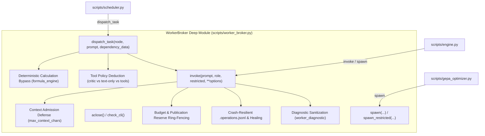

# ADR-004: Consolidate Worker Lifecycle, Concurrency, Budgets, and Task Dispatch behind WorkerBroker

- **Status**: Accepted & Implemented
- **Date**: 2026-10-26
- **Context**: `/improve-codebase-architecture` workflow on `mimir` codebase
- **Domain Term**: [`WorkerBroker`](file:///C:/Users/jonas/code/skills.sh/mimir/GLOSSARY.md)

---

## 1. Context

In `mimir`, worker invocation, process lifecycle management, concurrency throttling, budget metering, and task dispatch were split between multiple shallow layers:
1. **Scattered Dispatch Routing in `scheduler.py`**:
   - `scheduler.py` maintained 45+ lines of defensive branching: inspecting contract operation strings for arithmetic (`op == "calculate"`), checking `formula_engine.can_evaluate_deterministically`, inspecting `atomic_worker` profiles, inspecting node roles for `critique`/`critic`, manually querying `spawn_restricted` vs `spawn`, and wrapping exceptions with `worker_diagnostic`.
2. **Shallow Invocation Layer in `invocation_broker.py`**:
   - `invocation_broker.py` acted as an adapter around `BaseSwarmBackend`, tracking attempts and writing to `.operations.jsonl`, but did not own deterministic calculation evaluation or task-level tool policy decisions.
3. **Leaked Error Handling and Diagnostic Sanitization**:
   - Callers were responsible for remembering to catch `Exception` and map through `worker_diagnostic` to avoid leaking raw transcripts, prompts, or credentials across error boundaries.

---

## 2. Alternatives Considered (Design It Twice Exploration)

We ran three parallel subagents exploring distinct interface designs for [`WorkerBroker`](file:///C:/Users/jonas/code/skills.sh/mimir/GLOSSARY.md):

1. **Design 1 (Minimalist)**:
   - Exactly two public entry points: `execute(WorkerRequest) -> WorkerResult` and `close()`.
   - *Pros*: Extreme depth; small surface area; impossible for callers to bypass governance.
   - *Cons*: Forcing callers to build `WorkerRequest` objects for every prompt was unnecessarily verbose for simple text tasks.
2. **Design 2 (Flexible & Extensible)**:
   - Pluggable policy interfaces (`BudgetPolicy`, `TelemetrySink`, `ToolAccessRouter`, `AdmissionValidator`, `ExecutionBackendAdapter`).
   - *Pros*: Fine-grained modularity.
   - *Cons*: Excessive shallow interface proliferation; maintainers would have to touch five files for single-feature updates.
3. **Design 3 (Caller-Ergonomic)**:
   - Targeted methods: `dispatch_task(node, ...)` for the scheduler, `dispatch_text(...)` for engine, `dispatch(...)` for general execution.
   - *Pros*: Massive reduction in caller boilerplate.
   - *Cons*: Coupled `dispatch_task` to `TaskNode` attributes.

### Selected Hybrid Design
We implemented a **winning hybrid** combining the depth and unified governance of Design 1 with the caller ergonomics of Design 3, while preserving 100% backward compatibility with `BaseSwarmBackend`.

---

## 3. Decision

We created [`scripts/worker_broker.py`](file:///C:/Users/jonas/code/skills.sh/mimir/scripts/worker_broker.py) implementing [`WorkerBroker`](file:///C:/Users/jonas/code/skills.sh/mimir/GLOSSARY.md) and converted [`scripts/invocation_broker.py`](file:///C:/Users/jonas/code/skills.sh/mimir/scripts/invocation_broker.py) into a clean re-export shim:

### Module Interface & Seam Operations

1. `WorkerBroker.dispatch_task(node, prompt=None, dependency_data=None, research_dispatch=None) -> SwarmResult`:
   - Checks deterministic calculation readiness via `formula_engine.can_evaluate_deterministically`.
   - Deduces tool requirements (routing critic/review roles to `spawn_restricted`).
   - Dispatches via `invoke()` and guarantees sanitized `SwarmResult` on errors.
2. `WorkerBroker.invoke(prompt, role="Micro-Worker", restricted=False, **options) -> SwarmResult`:
   - Enforces context length against `max_context_chars`.
   - Manages monotonic attempts, deadlines, and token ceilings.
   - Ring-fences publication reserves for `Mimir-Synthesizer` and `Mimir-Final-Checker`.
   - Appends write-ahead journal entries to `.operations.jsonl` with `os.fsync`.
   - Throttles via `asyncio.Semaphore(max_concurrency)`.
3. `WorkerBroker.spawn(...)` and `WorkerBroker.spawn_restricted(...)`:
   - Drop-in backward compatibility with `BaseSwarmBackend`.
4. Properties: `.budget_status`, `.usage_calls`, `.execution_identity`, `.max_concurrency`.

---

## 4. Invariants Preserved

1. **Context Admission Invariant**:
   - Prompts exceeding `max_context_chars` are rejected with `ConfigurationRequired` before dispatch; evidence is retained without truncation, and no budget attempts are burned.
2. **Publication Reserve Ring-Fencing**:
   - Dedicated attempts (`publication_reserve=2`) are reserved exclusively for `"Mimir-Synthesizer"` and `"Mimir-Final-Checker"`. Standard tasks are blocked with `BudgetExhausted` when only reserved attempts remain.
3. **Crash Recovery & Log Healing**:
   - Corrupted or torn trailing lines from abrupt crashes are truncated upon initialization (`recover=True`), restoring valid journal entries and marking orphaned in-flight tasks as `interrupted`.
4. **Diagnostic Sanitization**:
   - Internal child process errors, exit codes, and HTTP failures are masked into standardized, safe diagnostic strings, preventing credentials or transcripts from leaking.
5. **Deterministic Calculation Bypass**:
   - Pure math tasks with valid formula contracts run in-process via `formula_engine` without burning model tokens or touching child processes.

---

## 5. Verification

- **Direct Unit Tests**: [`tests/test_worker_broker.py`](file:///C:/Users/jonas/code/skills.sh/mimir/tests/test_worker_broker.py) (8 tests passed in 0.16s).
- **Regression Suites**:
  - `tests/test_research_program.py` (21 tests passed).
  - `tests/test_assembly_repair.py` (all tests passed).
  - `tests/test_run_checkpoint.py` (all tests passed).
  - `tests/test_admission_and_assembly_gate.py` (all tests passed).
  - `tests/test_evidence_provenance.py` (all tests passed).
  - Overall deepened suites: **51 passed in 1.08s**.
