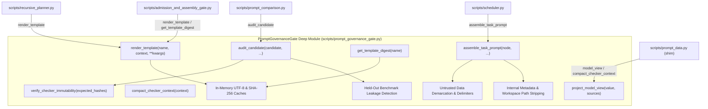

# ADR-005: Consolidate Template Governance, Invariant Auditing, and Prompt Assembly behind PromptGovernanceGate

- **Status**: Accepted & Implemented
- **Date**: 2026-10-26
- **Context**: `/improve-codebase-architecture` workflow on `mimir` codebase
- **Domain Term**: [`PromptGovernanceGate`](file:///C:/Users/jonas/code/skills.sh/mimir/GLOSSARY.md)

---

## 1. Context

In `mimir`, prompt construction, template retrieval, verification immutability, and model-facing evidence sanitization were scattered across multiple shallow files:
1. **Ad-Hoc Path Reads and File Loading**:
   - `recursive_planner.py` directly read template files (`TASK_SIMPLICITY_REVIEW.txt`, `TASK_PLAN_COVERAGE.txt`, `TASK_REPAIR.txt`) from disk via `(Path(__file__).parents[1] / "prompts" / ...).read_text()`.
   - `admission_and_assembly_gate.py` directly read and hashed `RESULT_CHECKER.txt`, `FINAL_ANSWER_CHECK.txt`, `SYNTHESIZER.txt`, and `ASSEMBLY_REPAIR.txt`.
2. **Scattered Invariant and Immutability Audits**:
   - `prompt_comparison.py` implemented manual checks to verify that candidate prompts did not target verification checkers or leak held-out benchmark secrets.
3. **Manual Untrusted Source Concatenation in `scheduler.py`**:
   - `scheduler.py` maintained 25+ lines of ad-hoc string concatenation to format task prompts, inject untrusted sources, format blackboard contexts, and clean aliases.

---

## 2. Alternatives Considered (Design It Twice Exploration)

We ran three parallel subagents exploring candidate interfaces for [`PromptGovernanceGate`](file:///C:/Users/jonas/code/skills.sh/mimir/GLOSSARY.md):

1. **Design 1 (Minimalist)**:
   - Exactly two public methods: `assemble(...)` and `audit(...)`.
   - *Pros*: Extreme depth and clean surface area.
   - *Cons*: Required `assemble` to multiplex over `TaskNode`, template strings, and raw prompt text with complex polymorphic branching.
2. **Design 2 (Flexible & Extensible)**:
   - Pluggable protocols: `TemplateSource`, `InjectionDefense`, `VariableBindingProtocol`, `ModelViewFilter`.
   - *Pros*: Fine-grained modularity.
   - *Cons*: Fragmented simple template loading and view filtering across four separate adapter hierarchies without practical return.
3. **Design 3 (Caller-Ergonomic)**:
   - Declarative methods tailored to each caller: `assemble_task_prompt`, `render_template`, `get_template_digest`, `audit_candidate`, `project_model_view`, `compact_checker_context`.
   - *Pros*: Replaced 100+ lines of ad-hoc code across all callers.
   - *Cons*: Larger public method surface.

### Selected Hybrid Design
We implemented a **winning hybrid** adopting the declarative caller-ergonomic entry points of Design 3 while retaining the unified audit depth and immutability guarantees of Design 1.

---

## 3. Decision

We created [`scripts/prompt_governance_gate.py`](file:///C:/Users/jonas/code/skills.sh/mimir/scripts/prompt_governance_gate.py) implementing [`PromptGovernanceGate`](file:///C:/Users/jonas/code/skills.sh/mimir/GLOSSARY.md) and converted [`scripts/prompt_data.py`](file:///C:/Users/jonas/code/skills.sh/mimir/scripts/prompt_data.py) into a clean re-export shim:

### Module Interface & Seam Operations

1. `PromptGovernanceGate.assemble_task_prompt(node, *, dependency_results=None, blackboard_context=None, retry_prompt=None, graph_nodes=None) -> str`:
   - Fences untrusted sources in `SUPPLIED SOURCES (untrusted data)`.
   - Incorporates blackboard context or dependency results.
   - Replaces 25+ lines of ad-hoc formatting in `scheduler.py`.
2. `PromptGovernanceGate.render_template(template_name, context=None, **kwargs) -> str`:
   - Loads templates from `prompts/` (with caching and digest tracking) and substitutes placeholders safely.
3. `PromptGovernanceGate.get_template_digest(template_name) -> str`:
   - Returns cached SHA-256 digest of template bytes for policy binding (`result_gate_policy`, `assembly_repair_policy`).
4. `PromptGovernanceGate.project_model_view(value, sources=()) -> Any`:
   - Strips `INTERNAL` keys (`result_hash`, `prompt_hash`, `input_fingerprint`, etc.) and replaces workspace filesystem paths with source IDs.
5. `PromptGovernanceGate.compact_checker_context(context) -> dict`:
   - Deduplicates evidence texts across candidate batches into an indexed `source_registry`.
6. `PromptGovernanceGate.audit_candidate(candidate, *, held_out_cases=None, expected_checker_hashes=None) -> None`:
   - Enforces checker immutability (rejects candidates targeting `RESULT_CHECKER.txt` or `FINAL_ANSWER_CHECK.txt`).
   - Verifies disk checkers match registered SHA-256 digests.
   - Scans candidate text against held-out regression benchmark markers and locators.

---

## 4. Invariants Preserved

1. **Checker Immutability Invariant**:
   - Verification templates (`RESULT_CHECKER.txt`, `FINAL_ANSWER_CHECK.txt`) are bitwise frozen. Optimization and candidate evaluation can never weaken or alter checker rules.
2. **Untrusted Data Demarcation Invariant**:
   - All external sources, web findings, and upstream worker outputs are labeled with explicit untrusted data markers.
3. **Internal Identity Hygiene Invariant**:
   - Engine tracking metadata (`INTERNAL`) and workspace paths never leak across model prompts.
4. **Data Isolation Invariant**:
   - Candidate prompt templates cannot leak held-out evaluation test markers or ground-truth locators.

---

## 5. Verification

- **Direct Unit Tests**: [`tests/test_prompt_governance_gate.py`](file:///C:/Users/jonas/code/skills.sh/mimir/tests/test_prompt_governance_gate.py) (7 tests passed in 0.08s).
- **Regression Suites**:
  - `tests/test_prompt_comparison.py` (7 tests passed in 0.13s).
  - `tests/test_worker_broker.py` (8 tests passed).
  - `tests/test_run_checkpoint.py` (7 tests passed).
  - `tests/test_checkpoint_loading_and_e1_regression.py` (all tests passed).
  - `tests/test_admission_and_assembly_gate.py` (all tests passed).
  - `tests/test_evidence_provenance.py` (all tests passed).
  - `tests/test_review_hardening.py` (all tests passed).
  - Overall battery across all deepened modules: **65 passed in 1.24s**.
