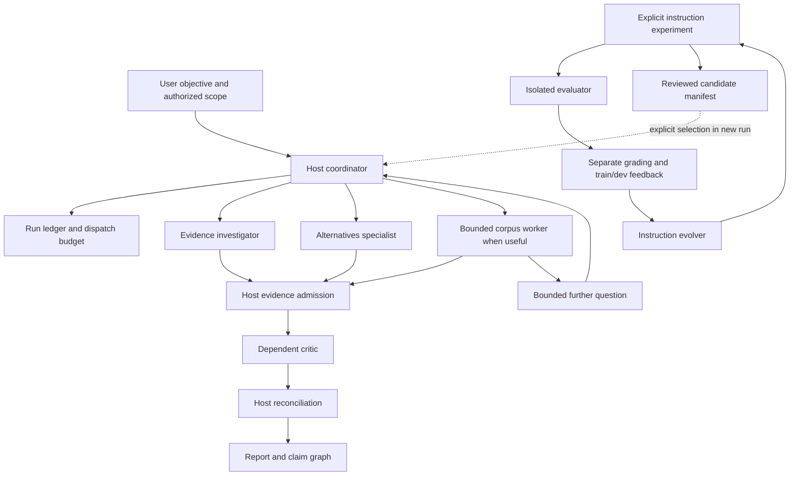

# Design and Mimir capability mapping

Mycroft moves the orchestration boundary from a Python engine to the existing
harness's coordinating agent. Native subagents do investigation, bounded corpus
analysis, critique and experimental instruction work. Durable files carry run
identity, admitted evidence and recovery state. The package itself contains
instructions, data contracts, harness adapters and optional PowerShell utilities.

## Team and module boundaries

The arrows to specialists describe possible roles, not a mandatory full team.
Review normally uses two specialists and one critic; corpus replaces or
partitions specialist work within the declared task cap. Host synthesis is a
role, not another routinely spawned executive. Optimization runs separately.

The stable interfaces are investigator inputs -> evidence record, admitted
records -> critic issues, admitted claims/critique -> final result, and train/dev
feedback -> instruction proposal. The host owns the policy around each call.
Children cannot reinterpret source text as authority to change those interfaces.

## Implementation-grounded transfer

These references describe the inspected Mimir checkout on 2026-10-22. They are
design provenance, not portable runtime dependencies; the Mycroft archive does
not need that checkout.

| Feature | Inspected Mimir source | Transfer and boundary |
| --- | --- | --- |
| Typed analysis | `scripts/dspy_runtime/programs.py`, `worker.py`, `research_contract.py` | Explicit immutable input/output signatures; optional native JSON enforcement and record validator. No DSPy compiler |
| Executable RLM | `scripts/dspy_runtime/interpreter.py`, `worker.py`, `source_store.py` | Native corpus search/read, source slicing and root-mediated recursion. No Deno/Pyodide, generated Python or interpreter state |
| Policies | `scripts/task_graph.py`, `engine.py` | single/review/swarm with dependency-ready tasks and one publication |
| JEV | `scripts/jev_gate.py`, `task_graph.py` | Same heuristic formula, evidence/ancestor protection, one threshold, optional-only pruning |
| Reflection | `scripts/gepa_optimizer.py`, `engine.py` | Material critic issues and bounded evidence-linked correction in routine research |
| Upstream GEPA | `scripts/dspy_runtime/optimization.py`, `optimize_program.py`, `evaluate_research.py` | Explicit instruction experiment with train/dev trace feedback, Pareto comparison and held-out rejection gate. GEPA-inspired, not upstream execution |
| Recovery | `scripts/run_manager.py`, `scheduler.py`, `engine.py` | Host-only receipts and immutable attempts, identity checks before reuse. No fsync/lock/atomicity guarantee from prompts |
| Budgets | `scripts/invocation_broker.py`, `owned_process.py` | Observable native dispatch/depth/concurrency accounting. Hard token/memory/process controls require the harness |

Mimir documentation records real upstream GEPA proposals but selection of the
original on its synthetic benchmark. Timing variation is not a demonstrated
optimization gain. Mycroft inherits no quality or performance claim from those
runs. The inspected candidate review/evaluation tooling has narrower coverage
than the training entrypoint; Mycroft's generic experimental protocol also needs
actual representative evaluation.

## Strongest portable guarantees

- Native dispatches use the current harness and provider route. No additional
  model service, credentials, Python environment or subprocess bridge is needed.
- All agent work, including repair, recursive questions and optimizer evaluations,
  consumes a declared coordinator budget. Critique is reserved before research.
- Structured sources distinguish primary retrieval from discovery, assertions
  from inference, design intent from operational observations and read scope
  from search scope. Conflicts and partial retrieval remain visible.
- Only the host admits worker results and writes shared state. Dependents consume
  admitted immutable attempts. Unavailable evidence never becomes success through
  synthesis, pruning or contract repair.
- Learned candidates and instruction candidates remain separate from curated
  guidance and selected instructions. Explicit reviewed selection controls change.

These are protocol obligations. Optional utilities check structural invariants;
the host/harness executes them. A model can still fail to follow instructions,
and a schema cannot establish factual entailment. Role files do not impose a
read-only sandbox on inherited remote tools. Actual source access, permission
boundaries and cleanup must be observed.

## Recovery and context strategy

Externalize corpus indexes, evidence and admitted records rather than replaying
every worker transcript into the host. Dispatch minimal packets with relevant
role/contract text and bounded evidence. Track every indexed slice even when
unread. Reopen source passages for consequential joins and critique.

A run resumes from source/instruction/output identity and remaining budget, not
from an assumed live child conversation. Native threads may survive, disappear
or retain old context; inspect actual state before retry. When only an idle
thread can be reused, restate task identity and full instructions. Experimental
evaluation requires fresh isolated contexts; reuse is unsuitable for blinding.

This design favors explicit gaps over claiming engine-grade recovery. Hard
deadlines, token/cost accounting, source digests and atomic publication can improve
with harness features, without changing investigator interfaces.

## Evaluation boundaries

Instruction optimization uses separate experiment accounting and fresh evaluator
contexts. The ordinary run validator checks research ledgers; it does not validate
an optimizer's Pareto calculations, source-group split or held-out isolation.
Mechanical fact grading, human judgments and model rubric estimates must remain
separate in the comparison. Optimization without a representative reviewed dataset
produces a proposal workflow, not demonstrated improvement.

The bundled corpus also tests evidence semantics after capture: a search snippet
saved as a Markdown file is still discovery evidence for its underlying claim.
Reading the file establishes its text, not the truth of the snippet. Corpus-index
IDs identify documents/revisions; task-prefixed citation IDs identify retrieved
spans. Their mapping belongs in host-owned source records.
